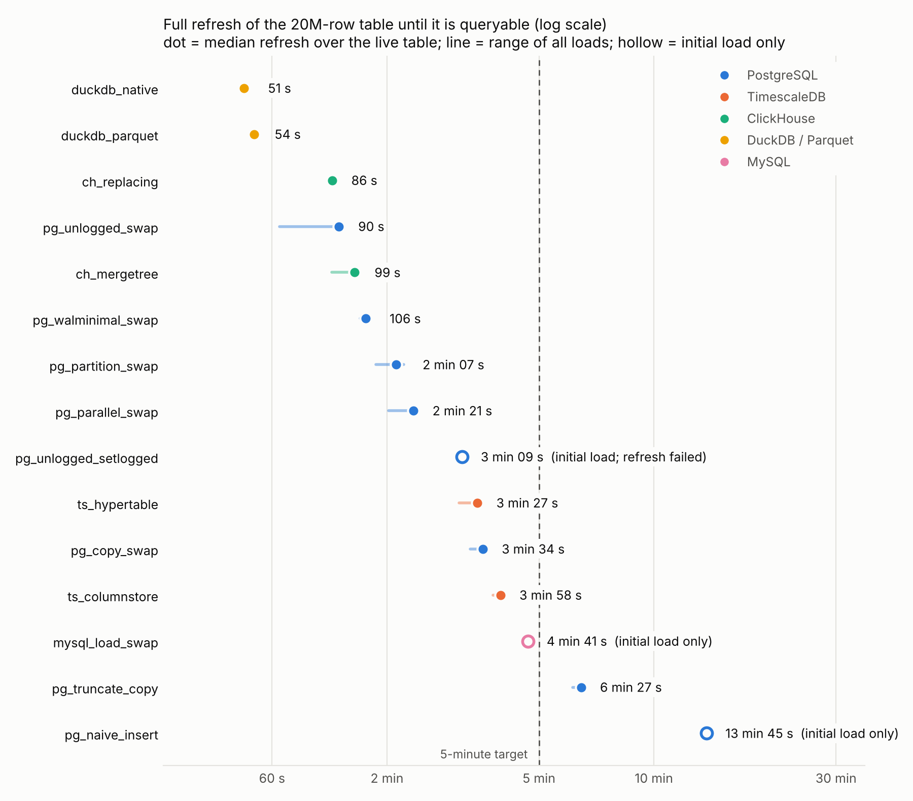
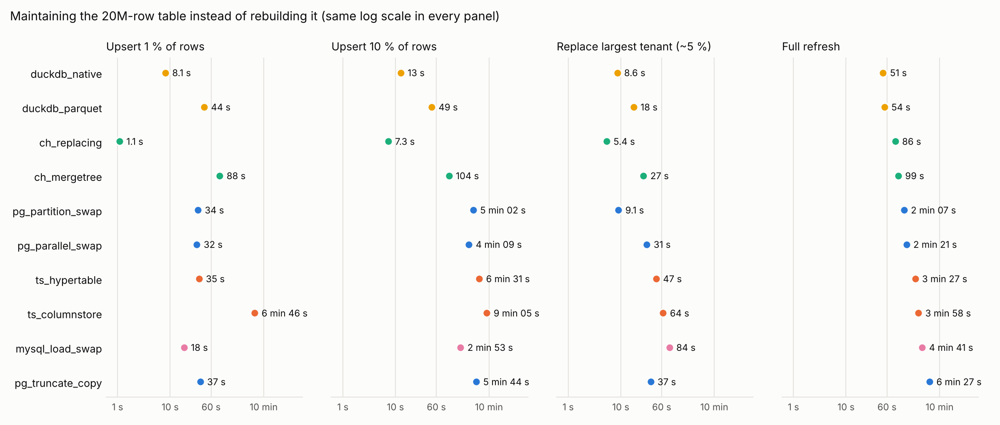

# bigtable2db

**How do you get one big table into a serving database in under 5 minutes — and which platform should hold it?**

A batch job produces a table of **20 million rows, 9 columns (integers, floats, text), ~10 GB of data plus two
~3 GB indexes**. A SaaS application reads it. Today it is replaced by a full refresh into PostgreSQL, and that
refresh has become the bottleneck as clients grow.

This repository measures 17 ways of doing it on 5 engines, on the same machine, with the same data, with every
result checksum-verified — and estimates 10 managed cloud platforms from vendor price lists.



## The short version

1. **The method matters more than the platform.** Staying on PostgreSQL and changing only *how* the table is
   loaded takes the 20M-row refresh from **13 min 45 s** (batched `INSERT`s) or **6 min 27 s** (`TRUNCATE` +
   `COPY`) to **2 min 21 s** — crash-safe, replicated, on any managed PostgreSQL — and the application keeps
   reading the old table until the new one is ready. The recipe: load a *new* table with parallel `COPY`, build
   the indexes *afterwards*, swap by rename.
2. **Columnar engines refresh faster and store 7× less, but serve slower.** ClickHouse (86–99 s, 2.2 GB) and
   Parquet + DuckDB (51–54 s, 2.0 GB) beat PostgreSQL (15.3 GB) on refresh and on aggregates. Their point
   lookups take 2–4 ms instead of 0.2 ms and they sustain 3–24× fewer lookups per second. They also cannot
   hold the product's other transactional tables, so they are a second system beside PostgreSQL.
3. **"Apply only what changed" is not automatically cheaper.** At 20M rows a scattered 1 % upsert takes 32 s,
   but a 10 % upsert takes **4 min 09 s — longer than rebuilding the whole table** — because the table no longer
   fits in memory and every changed row is a random disk read. Break-even on this machine is near 5 % of rows.
4. **If changes arrive per client, partition by tenant.** Replacing the largest tenant (1M rows, 5 % of the
   table) takes **9 s** by partition exchange instead of 31 s, and the full refresh is no slower. The cost:
   lookups that do not name the tenant are 6× slower.
5. **TimescaleDB and MySQL do not help here.** A hypertable makes the refresh 47 % slower and no query
   faster; its columnstore is 3.7× smaller but manages 35 lookups per second. MySQL needs 4 min 41 s for the
   same pattern.
6. **Cloud warehouses are not serving stores (estimate, not measured).** Redshift, Snowflake and BigQuery load
   this table in minutes, but answer lookups in hundreds of milliseconds, and serving an application from them
   keeps compute running around the clock (roughly $1,100–2,200 per month). Beside PostgreSQL, as batch stores,
   they cost under $100.

## Results at 20M rows

One 4-vCPU / 15 GB / NVMe machine; client and server share it. "Refresh" is the median time from the first
Parquet byte read until queries see the new table with both access paths and statistics, **measured while an
application reader polls the live table every 20 ms**.

| Solution | Full refresh | App can read during refresh | Point lookup p50 | Lookups/s (8 clients) | Per-tenant dashboard p50 | Size |
|---|--:|---|--:|--:|--:|--:|
| **Parquet + DuckDB** (`duckdb_parquet`) | **54 s** | yes | 3.5 ms | 936 | 4.8 ms | **2.0 GB** |
| **DuckDB file** (`duckdb_native`) | **51 s** | yes | 2.5 ms | 1,396 | 2.5 ms | 2.8 GB |
| **ClickHouse** (`ch_mergetree`) | 99 s | yes | 4.2 ms | 314 | 4.1 ms | 2.2 GB |
| **ClickHouse**, mutable (`ch_replacing`) | 86 s | yes | 3.7 ms | 200 | 3.9 ms | 2.1 GB |
| PostgreSQL, no WAL (`pg_unlogged_swap`) ¹ | 90 s | yes | 0.2 ms | ≈ 4,800 | 45 ms | 15.3 GB |
| PostgreSQL, `wal_level=minimal` (`pg_walminimal_swap`) ² | 106 s | yes | 0.2 ms | ≈ 4,800 | 45 ms | 15.3 GB |
| **PostgreSQL, partitioned by tenant** (`pg_partition_swap`) | 2 min 07 s | yes | 0.21 ms | 3,740 | 42 ms | 15.3 GB |
| **PostgreSQL, parallel COPY + swap** (`pg_parallel_swap`) | **2 min 21 s** | yes | **0.21 ms** | **4,832** | 45 ms | 15.3 GB |
| TimescaleDB hypertable (`ts_hypertable`) | 3 min 27 s | yes | 0.15 ms | 4,170 | 60 ms | 15.3 GB |
| PostgreSQL, single COPY + swap (`pg_copy_swap`) | 3 min 34 s | yes | 0.2 ms | ≈ 4,800 | 45 ms | 15.3 GB |
| TimescaleDB columnstore (`ts_columnstore`) | 3 min 58 s | yes | 2.3 ms | 35 | 4.3 ms | 4.1 GB |
| MySQL 8.4 (`mysql_load_swap`) ³ | 4 min 41 s | yes | 0.43 ms | 4,678 | 187 ms | 16.3 GB |
| PostgreSQL, `TRUNCATE` + `COPY` (`pg_truncate_copy`) | 6 min 27 s | **no — blocked 6 min 19 s** | 0.16 ms | 4,903 | 97 ms | 17.7 GB |
| PostgreSQL, batched `INSERT` (`pg_naive_insert`) ³ | 13 min 45 s | no | – | – | – | 17.6 GB |

¹ Not crash-safe: the table is empty after a crash, and it does not exist on replicas.
² Self-hosted only; disables replication and point-in-time recovery for the whole server.
³ Initial load; no refresh over a live table was run at 20M (see [How to read the numbers](#how-to-read-the-numbers)).
"≈ 4,800" marks solutions whose queries were not re-measured at 20M because they produce the same table as `pg_parallel_swap`.

Every number, at both scales, with phases, percentiles and reader statistics:
[`results/RESULTS.md`](results/RESULTS.md) · raw JSON in [`results/raw/`](results/raw) ·
[`results/summary.csv`](results/summary.csv).

## Which one should I use?

| If… | Use | Why |
|---|---|---|
| the application needs sub-millisecond lookups, the product's other tables are in PostgreSQL, and the table is up to a few tens of millions of rows | **PostgreSQL, `pg_parallel_swap` pattern** | 2 min 21 s at 20M with zero reader errors; no new system, no new cost; works on RDS / Aurora / Cloud SQL as an ordinary role |
| new data arrives **per client** ("tenant X was recomputed") | **PostgreSQL partitioned by tenant**, exchange the partition | 9 s per 1M-row tenant, no bloat, nothing else touched; full refresh still 2 min 07 s. Add `tenant_id` to every lookup or accept 6× slower secondary lookups |
| fewer than ~5 % of rows change per cycle, scattered over the table | **upsert** (`INSERT … ON CONFLICT`) into the same table | 32 s for 1 % at 20M. Above ~5 % rebuild instead. Budget for bloat (+13 % after changing 16 % of the rows) and vacuum |
| the table is heading for 100M+ rows, or dashboards and aggregates matter more than key lookups | **ClickHouse beside PostgreSQL** | 86–99 s at 20M, 7× smaller, aggregates 10–19× faster. Accept 4 ms lookups and ~300 lookups/s per 4 cores, and a second system to operate |
| readers are your own services or batch jobs that can embed a library, and cost matters most | **Parquet on object storage + DuckDB** | 54 s, 2 GB, no server at all. Lookups 2–4 ms from local disk; single writer; nothing that speaks only the PostgreSQL protocol can read it |
| the table is a pure cache (source files kept, an empty table after a crash is acceptable, no replicas read it) | **PostgreSQL `UNLOGGED` + swap** | 90 s — the fastest PostgreSQL variant. Read footnote ¹ first |

Things the measurements argue against:

* **`pandas.to_sql(method="multi")`** — 142 s per million rows into the indexed table, about 47 minutes for
  20M: 39× slower than the swap pattern on the same server.
* **Loading `UNLOGGED` and then `ALTER TABLE … SET LOGGED`** — `SET LOGGED` rewrites everything through the WAL
  (125 s at 20M, more than the load it was meant to speed up) and needs a third copy of the data; the refresh ran
  out of disk here.
* **TimescaleDB for a table that is replaced, not appended to**, and **migrating to MySQL** for load speed.
* **Serving the application directly from Redshift, Snowflake, BigQuery or Athena.**

## What the measurements show

### 1. The PostgreSQL ladder: same server, same table, different method

| Step | 20M refresh | What changed |
|---|--:|---|
| batched multi-row `INSERT` into the indexed table | 13 min 45 s | – |
| `TRUNCATE` + one `COPY` into the indexed table | 6 min 27 s | `COPY` instead of `INSERT` |
| one `COPY` into a new table, indexes afterwards, rename | 3 min 34 s | no index maintenance during load; readers stay online |
| 4 `COPY` streams, both indexes built at once, `COLLATE "C"` keys | **2 min 21 s** | parallelism; byte-wise key comparison |
| …into an `UNLOGGED` table | 90 s | no WAL (and no crash safety) |

Loading into a table that already has its indexes means two random B-tree insertions per row on 110-character
keys. That is slow (378 s for the load alone) and leaves the indexes 40 % larger (4.0 GB instead of 2.9 GB each)
because pages split instead of being packed. Building the indexes afterwards is one sort each.

Each lever was also measured in isolation ([`docs/notes/postgres.md`](docs/notes/postgres.md)): four parallel
`COPY` streams −36 %, `COLLATE "C"` on the text keys −15 %, concurrent index builds −14 %, all three −53 %;
binary `COPY` (ADBC) a further −27 % on the `COPY` phase, which the final solution does not use yet.
`synchronous_commit=off` and a larger `maintenance_work_mem` made no measurable difference.

### 2. Refresh versus maintain



| 20M rows | Upsert 1 % | Upsert 10 % | Replace largest tenant (5 %) | Full refresh |
|---|--:|--:|--:|--:|
| PostgreSQL | 32 s | 4 min 09 s | 31 s | 2 min 21 s |
| PostgreSQL, partitioned by tenant | 34 s | 5 min 02 s | **9.1 s** | 2 min 07 s |
| ClickHouse `ReplacingMergeTree` | **1.1 s** | **7.3 s** | 5.4 s | 86 s |
| ClickHouse `MergeTree` (rebuild + swap) | 88 s | 104 s | 27 s | 99 s |
| DuckDB file | 8.1 s | 13 s | 8.6 s | 51 s |
| Parquet + DuckDB (rewrite files) | 44 s | 49 s | 18 s | 54 s |
| MySQL | 18 s | 2 min 53 s | 84 s | 4 min 41 s |
| TimescaleDB columnstore | 6 min 46 s | 9 min 05 s | 64 s | 3 min 58 s |

* **In PostgreSQL the answer flips with memory.** At 5M rows (3.8 GB, cached) a 10 % upsert costs half a
  refresh. At 20M (15.3 GB on a 15 GB machine) it costs almost two. Four times the rows, eighteen times the
  upsert time.
* **Cheap writes are paid for by readers.** ClickHouse `ReplacingMergeTree` upserts in a second, but every read
  must de-duplicate (`FINAL`), and right after maintenance the secondary lookup went from 23 ms to 452 ms until
  background merges caught up.
* **Immutable files punish scattered changes.** A 1 % upsert spread over all Parquet files rewrites all of them.
* **Incremental maintenance leaves bloat.** PostgreSQL was 13 % larger after the three operations
  (15.3 → 17.4 GB); a rebuild resets it.

Details and the upsert-method comparison (`ON CONFLICT` vs `MERGE` vs delete + `COPY`: all within 30 %):
[`docs/notes/postgres_incremental.md`](docs/notes/postgres_incremental.md).

### 3. Staying available while the table is replaced

All swap-based solutions showed **zero failed and zero empty reads** across every refresh at both scales.
What differs is the longest pause a reader saw at the moment of the swap:

| 20M rows | Longest reader pause during refresh |
|---|--:|
| Parquet + DuckDB, DuckDB file, ClickHouse | 0.1 – 1.5 s |
| PostgreSQL swap variants | 0.4 – 2.0 s |
| TimescaleDB hypertable | 6.0 s |
| PostgreSQL partitioned (15 partitions) | 8.0 s |
| PostgreSQL `TRUNCATE` + `COPY` | 6 min 19 s |

**Where the one-second pause comes from — verified.** It is not the swap itself, which is a few catalog updates.
Some time after a bulk load, autovacuum starts working on the new table. The swap needs an exclusive lock on the
live table; PostgreSQL makes that request wait `deadlock_timeout` (1 s by default) before it cancels the
autovacuum worker, and every reader queues behind the pending lock for the same second. Reproduced in isolation
at 5M rows ([`bench/labs/swap_stall.py`](bench/labs/swap_stall.py), [`results/labs/`](results/labs)):

| Condition at the moment of the swap | Worst read during the refresh | What the reader waited on |
|---|--:|---|
| autovacuum worker active on the live table | **1,003 ms** | relation lock, behind the swap's `LOCK TABLE … ACCESS EXCLUSIVE`; server log: 1 autovacuum task cancelled |
| `autovacuum_enabled = false` on the live table | 162 ms | disk reads only, no lock wait |
| refresh started before autovacuum did | 21 ms | nothing |

For a table that is replaced wholesale and never updated in place, create it with `autovacuum_enabled = false`
and run `VACUUM (ANALYZE)` yourself at a time that does not collide with the next swap. The 6 s (hypertable) and
8 s (15 partitions) pauses are consistent with the same wait repeated per child table; that part is an
inference and was not isolated. **The benchmark numbers above were measured without this fix.**

Two more lessons from the runs: `TRUNCATE` + `COPY` blocks every reader for the whole load, and on a TimescaleDB
hypertable, dropping the old table *inside* the swap transaction deadlocked with a reader — rename in the
transaction, drop after the commit.

### 4. Serving the application

| 20M rows, p50 / p95 ms | Point lookup | Secondary lookup | Per-tenant dashboard | Full-table aggregate | Lookups/s, 8 clients |
|---|--:|--:|--:|--:|--:|
| PostgreSQL | 0.21 / 0.37 | 0.14 / 0.29 | 45 / 184 | 2,237 / 2,311 | 4,832 |
| MySQL | 0.43 / 0.72 | 0.39 / 0.62 | 187 / 669 | 104,513 / 113,655 | 4,678 |
| DuckDB file | 2.5 / 4.1 | 2.1 / 3.7 | 2.5 / 11 | 42 / 42 | 1,396 |
| Parquet + DuckDB | 3.5 / 5.6 | 2.7 / 3.3 | 4.8 / 8.5 | 499 / 571 | 936 |
| ClickHouse `MergeTree` | 4.2 / 6.5 | 13 / 20 | 4.1 / 9.1 | 120 / 122 | 314 |
| TimescaleDB columnstore | 2.3 / 3.0 | 205 / 247 | 4.3 / 15 | 498 / 580 | 35 |

Row stores win key lookups by an order of magnitude; column stores win everything that reads many rows by an
order of magnitude. The per-tenant dashboard query — the one a SaaS customer actually waits for — is 10× faster
on any columnar option. If that query matters and the table stays in PostgreSQL, a small pre-aggregated table
per tenant is the cheap fix.

### 5. Does the 5-minute budget survive growth?

On this 4-vCPU machine, going from 5M to 20M rows cost every method between 4× and 6× the time (see the scaling
table in [`results/RESULTS.md`](results/RESULTS.md)). Extrapolating — not measured — the 5-minute budget ends at
roughly:

| Method | 20M measured | 5-minute limit on this machine (extrapolated) |
|---|--:|--:|
| PostgreSQL `pg_parallel_swap` | 2 min 21 s | ≈ 35–40M rows |
| ClickHouse | 86–99 s | ≈ 55–65M rows |
| Parquet + DuckDB | 51–54 s | ≈ 80M rows |

More cores move all three limits: the `COPY` phase scaled with streams up to the core count, and index builds,
ClickHouse merges and DuckDB sorts are parallel too. What does not scale with cores is the *shape* of the
problem: a full rebuild is O(table), so at 100M rows the durable answer is to stop rebuilding everything —
partition by tenant and exchange what changed.

### 6. Cost

The measured engines are free software; the cost is the machine. **The PostgreSQL pattern needs no new
infrastructure**, only free disk for a second copy of the table during the refresh (2.5× the table size
including WAL).

Managed platforms, **estimated** from price lists on 2026-11-21 for this workload (one 16 GB table, 3 refreshes
a day, 10–50 lookups per second around the clock, us-east-1 list prices). Nothing in this table was measured;
sources, arithmetic and confidence for every figure are in [`docs/cloud_estimates.md`](docs/cloud_estimates.md).

| Platform | Est. refresh | Lookup latency class | Hosts the other OLTP tables | Est. monthly cost |
|---|---|---|---|---|
| RDS for PostgreSQL | as measured here, or slower | single-digit ms | yes | $370 – $1,490 (including those tables) |
| Aurora PostgreSQL | as measured here, or slower | single-digit ms | yes | $550 – $2,120 |
| Tiger Cloud (TimescaleDB) | as measured here | single-digit ms | yes | $640 – $1,880 (third-party prices) |
| ClickHouse Cloud | 0.5 – 2 min on ≥ 8 vCPU | tens of ms | no | $160 – $1,750 |
| S3 + Athena | time to write Parquet | seconds | no | < $10 as a batch store; $1,300 – $6,600 if queried per lookup |
| MotherDuck | unknown | tens – hundreds of ms | no | ≈ $250 – $2,000 (sources conflict) |
| Amazon Redshift | unknown, likely 1 – 5 min | hundreds of ms | no | $280 – $2,200 always-on; $25 – $90 batch-only |
| Snowflake | 1 – 4 min | hundreds of ms | partially | $1,490 – $2,240 always-on; $30 – $50 batch-only |
| BigQuery | 1 – 3 min plus queueing | hundreds of ms – seconds | no | $0 – $25 batch-only; $1,460 – $7,800 if queried per lookup |
| DynamoDB import from S3 | unknown | single-digit ms | no | ≈ $135 – $155 (lookups only) |

Two things on managed PostgreSQL that the local runs cannot show: gp3 volumes below 400 GiB are capped at
125 MiB/s, which a 16 GB load plus WAL in under 5 minutes would saturate, and Aurora Standard bills the refresh
I/O (I/O-Optimized is the safer choice). Both are inferences from the price lists, not measurements.

## How to read the numbers

* **Hardware.** 4 vCPU Intel Xeon 2.1 GHz, 15 GB RAM, virtual NVMe (≈ 940 MB/s sequential write). The 15.3 GB
  PostgreSQL table does not fit in memory, which is the realistic regime. Absolute times will be lower on bigger
  hardware; the ratios between methods and the direction of every finding are what carry over.
* **One node, no replication.** WAL volume (≈ 0.5 GB per million rows for a logged load) and replica lag are
  discussed in the notes, not measured.
* **Client and server share the machine**, so the load generator competes with the database for the 4 cores.
  Lookups-per-second figures are for comparing engines with each other, not capacity planning.
* **Verification.** After every load, refresh, upsert and tenant replacement, `count(*)`, two column sums and
  `max(id)` must equal the generator's manifest; all four queries must return the reference answers computed by
  DuckDB over the source Parquet. Two runs did not pass and are reported as such: `pg_unlogged_setlogged` at 20M
  (out of disk during refresh) and the first `ts_hypertable` run at 5M (deadlock, see section 3; kept as
  `results/raw/ts_hypertable__5M__v1swap.json`).
* **Repetitions.** Three full loads per solution (one initial, two refreshes under read load) except the slow
  ones (`pg_copy_swap`, `pg_truncate_copy`: two; `pg_naive_insert`: one). Spread between repetitions was below
  5 % for every solution except `pg_unlogged_swap` and `pg_partition_swap` (≈ 10 %).
* **Not everything ran at 20M.** Five PostgreSQL variants differ from `pg_parallel_swap` only in how the table
  is loaded, so only their load and refresh were measured there. `pg_incremental` and `ts_plain_control` are
  5M-only controls. MySQL at 20M is a single load: two table copies plus binary log plus redo log do not fit on
  this machine's 70 GB disk.
* **Synthetic data.** Text is built from a 2,000-word vocabulary so it compresses like real text; each item's
  two text keys repeat over 20 periods. Different data shifts the columnar compression ratios (here ≈ 7×).
* **The swap was changed between the 5M and 20M matrices** (old table dropped after the rename commits instead
  of inside the transaction, after the hypertable deadlock). The ten affected 5M runs were repeated; the
  originals are kept as `*__5M__v1swap.json`. Times moved by less than 10 %.
* **Cloud platforms are estimates** and are never mixed into measured tables.

## Reproduce

Requirements: Linux, Docker, Python ≥ 3.11, [`uv`](https://docs.astral.sh/uv/), about 70 GB of free disk for the
20M scale.

```bash
uv venv .venv && uv pip install -r pyproject.toml
export B2D_DATA=/var/lib/bench/data B2D_WORK=/var/lib/bench/engines   # defaults

python -m bench.datagen --scale 1M                      # deterministic dataset (20M takes ~80 s)
python -m bench.run --list                              # all solutions
python -m bench.run --solution pg_parallel_swap --scale 1M
python -m bench.matrix --scales 5M,20M --tag final      # everything, strictly sequential (~4 h)
python -m bench.report --tag final                      # tables + charts

python -m bench.solutions.pg_strategies --scale 1M --suite pipeline,streams,encoders,index,index_c
python -m bench.labs.swap_stall --solution pg_parallel_swap --scale 5M
```

## Repository map

| Path | What |
|---|---|
| [`PLAN.md`](PLAN.md) | problem statement, dataset, protocol, fairness rules |
| [`PROGRESS.md`](PROGRESS.md) | what happened when, including what went wrong |
| [`bench/datagen.py`](bench/datagen.py) | dataset, deltas, expected checksums, reference query answers |
| [`bench/run.py`](bench/run.py) | the protocol every solution goes through |
| [`bench/solutions/`](bench/solutions) | one module per engine family; each solution is a small class |
| [`results/RESULTS.md`](results/RESULTS.md) | generated tables for 5M and 20M |
| [`results/labs/`](results/labs) | single-lever experiments and the swap diagnostic |
| [`docs/notes/`](docs/notes) | per-engine engineering notes: [PostgreSQL loading](docs/notes/postgres.md), [PostgreSQL maintenance and partitioning](docs/notes/postgres_incremental.md), [TimescaleDB](docs/notes/timescaledb.md), [ClickHouse](docs/notes/clickhouse.md), [DuckDB / Parquet](docs/notes/duckdb.md), [MySQL](docs/notes/mysql.md) |
| [`docs/cloud_estimates.md`](docs/cloud_estimates.md) | managed-platform cost and load-time estimates with sources |
